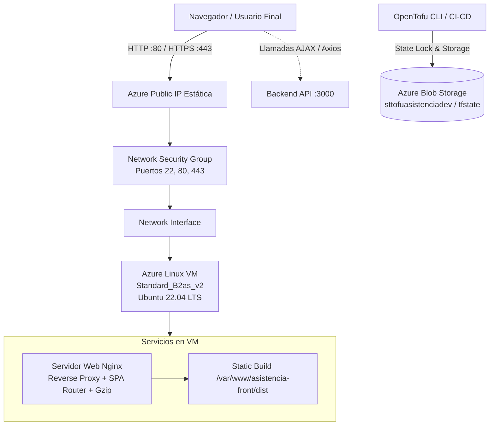

# Infraestructura como Código (IaC) - Asistencia Frontend en Azure

Este repositorio contiene la definición en **OpenTofu** para aprovisionar y gestionar la infraestructura en **Microsoft Azure** del frontend de la aplicación de control de asistencia (React + Vite + Nginx en modo SPA), optimizado para el **plan gratuito de Azure**.

---

## 🏛 Arquitectura de Infraestructura



### Recursos Provisionados
- **Grupo de Recursos**: `rg-vm-asistencia-front-dev-<sufijo>` (`swedencentral`).
- **Red Virtual (VNet)**: `10.1.0.0/16` con subred dedicada `subnet-frontend` (`10.1.1.0/24`).
- **IP Pública Estática**: SKU Standard con nombre DNS FQDN asignado.
- **Network Security Group (NSG)**: Firewall perimetral permitiendo SSH (puerto 22), HTTP (puerto 80) y HTTPS (puerto 443).
- **Máquina Virtual Linux**: `Standard_B2as_v2` (2 vCPU, 2 GB RAM, serie B con ráfagas, 100% elegible para Azure Free Trial).
- **Disco OS**: 30 GB Standard HDD (optimizado para plan gratuito).
- **Cloud-Init Automatizado**:
  - Configuración de 1 GB de Swap para compilación fluida de TypeScript y Vite.
  - Instalación y configuración de Nginx para Single Page Applications (`try_files $uri $uri/ /index.html`).
  - Instalación de Node.js 20 LTS.
  - Generación de `.env` con la URL del Backend (`VITE_API_URL`).
  - Script utilitario de compilación y recarga: `~/deploy.sh`.
  - Página HTML de bienvenida elegante mientras se sube el código fuente.

---

## 🔒 Estado Remoto en Azure Blob Storage

El archivo de estado (`.tfstate`) se almacena de forma remota y segura en Azure con bloqueo de concurrencia:
- **Resource Group**: `rg-asistencia-tfstate`
- **Storage Account**: `sttofuasistenciadev`
- **Container**: `tfstate`
- **Key**: `frontend.terraform.tfstate`

---

## 🚀 Despliegue Paso a Paso

### 1. Prerrequisitos
- [Azure CLI](https://learn.microsoft.com/en-us/cli/azure/install-azure-cli) instalado y logueado:
  ```bash
  az login
  ```
- [OpenTofu](https://opentofu.org/) v1.6 o superior:
  ```bash
  tofu version
  ```

### 2. Configurar Variables
Copia el archivo de plantilla y completa tus configuraciones:
```bash
cp terraform.tfvars.example terraform.tfvars
```

Edita `terraform.tfvars`:
```hcl
project_name    = "asistencia"
environment     = "dev"
location        = "swedencentral"
admin_username  = "azureuser"
admin_password  = "TuPasswordSeguro123!" # Cambiar obligatoriamente
vite_api_url    = "http://51.12.93.59:3000/api/v1/" # URL de la VM Backend
repo_url        = "https://github.com/Joandrr/asistencia-front.git"
```

### 3. Comandos de OpenTofu

```bash
# 1. Inicializar con el backend remoto en Azure
tofu init

# 2. Validar sintaxis y configuración
tofu validate

# 3. Previsualizar cambios
tofu plan

# 4. Aprovisionar infraestructura
tofu apply
```

### 4. Salidas Importantes (Outputs)
Al finalizar `tofu apply`, obtendrás:
- **`frontend_url`**: Dominio FQDN en Azure (ej: `http://vm-asistencia-front-dev-ikd40.swedencentral.cloudapp.azure.com`).
- **`frontend_ip_url`**: URL directa por IP pública (ej: `http://20.240.140.89`).
- **`ssh_connection_command`**: Comando directo para conectarte vía SSH.
- **`deploy_command`**: Comando para compilar y recargar Nginx en la VM (`ssh azureuser@<IP> '~/deploy.sh'`).

---

## 🔄 Despliegue y Actualización del Frontend

### Opción A: Vía Git (Recomendada)
Si definiste `repo_url`:
```bash
ssh azureuser@<IP-PUBLICA> '~/deploy.sh'
```

### Opción B: Vía SCP (Subida Manual)
```bash
scp -r ../../../../../asistencia-front/. azureuser@<IP-PUBLICA>:/var/www/asistencia-front/
ssh azureuser@<IP-PUBLICA> '~/deploy.sh'
```

---

## 💡 Optimización para Azure Free Trial

- **Apagar VM cuando no esté en uso**:
  Para conservar tus créditos de Azure Free Trial:
  ```bash
  az vm deallocate --resource-group <NOMBRE_RG> --name <NOMBRE_VM>
  ```
  Para reanudarla:
  ```bash
  az vm start --resource-group <NOMBRE_RG> --name <NOMBRE_VM>
  ```

---

## 📦 Instrucciones para Subir a un Repositorio GitHub Independiente

Para publicar este código en su propio repositorio de GitHub:

```bash
# 1. Inicializar repositorio git local (si aún no lo está)
git init

# 2. Agregar origen remoto
git remote add origin https://github.com/modulo2-IaC/azure-OpenTofu-frontend.git

# 3. Verificar que .gitignore proteja los archivos sensibles
git status
# Asegúrate de que NO aparezcan terraform.tfvars ni archivos .tfstate

# 4. Crear commit inicial
git add .
git commit -m "feat: initial OpenTofu infrastructure for frontend VM with Azure remote state"

# 5. Subir a GitHub
git branch -M main
git push -u origin main
```
